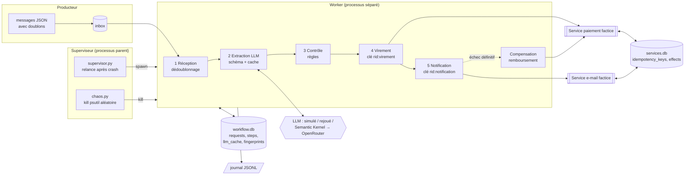

# Notes de frais sous chaos — workflow agentique résilient et idempotent

## Groupe

- **Nom du groupe :** transformers
- **Membres (comptes GitHub) :** @nathan138 · @Marko075 · @TODO-pseudo-alexandre

## Sujet

- **Identifiant du catalogue :** B5 — Workflow agentique résilient et idempotent
- **Problématique :** un workflow outillé qui appelle un LLM puis déclenche des effets externes (virement, e-mail)
  peut-il subir des **crashs brutaux**, des **doublons de livraison** et des **pannes transitoires** sans jamais
  répéter ses effets ? Le verrou est la sémantique d'exécution (*exactly-once effect*), pas le nombre d'agents.
- **MVP :** 5 étapes persistées, clés d'idempotence, reprise après crash, compensation d'une action réversible,
  campagne d'au moins 40 pannes injectées comparée à une baseline naïve.

**Scénario métier.** Des notes de frais arrivent en texte libre (« Déjeuner client le 12/10/2026 : 34,50 € TTC »).
Le workflow : ① réception et dédoublonnage par `request_id` → ② extraction structurée par LLM (JSON validé par
schéma, mis en cache) → ③ contrôle (plafonds par catégorie, dates, doublon métier) → ④ virement simulé (service
factice à la Stripe, avec clé d'idempotence) → ⑤ notification simulée (e-mail, idempotent). Si la notification
échoue définitivement, le virement est **compensé** (remboursement) et la demande passe en `COMPENSATED`.

## Résultats en bref

Campagne : 5 seeds × 40 demandes par mode, kills aléatoires du worker, pannes 500/timeout, doublons de livraison.

| Mesure (5 runs par mode) | Naïf (baseline) | **Protégé** |
|---|---:|---:|
| Crashs du worker injectés (kills `psutil` + points de crash) | 65 | 49 |
| Pannes injectées au total (crashs, 500/timeouts, LLM, doublons) | 201 | 146 |
| Taux de complétion | 100 % | 100 % |
| **Effets externes en double** (virements, e-mails, remboursements) | **94** | **0** |
| Demandes incohérentes (effets nets ≠ statut final) | 44 / 200 | 0 / 200 |
| Étapes ré-exécutées après crash | 278 | 0 |
| Appels LLM (pour 200 demandes) | 303 | 213 |
| Temps de reprise p50 / p95 | 0,36 s / 0,40 s | 0,41 s / 0,47 s |

Vrai LLM (`qwen/qwen3.8-flash` via OpenRouter + Semantic Kernel) sur 10 demandes variées : **100 % des champs
corrects** (montant, devise, catégorie, date), un crash forcé juste après l'appel LLM récupéré **via le cache sans
nouvel appel**, 0 doublon, **11 appels réels consommés sur le budget de 150**.

Détails : [results/report.html](results/report.html) (rapport statique), [notebooks/analyse.ipynb](notebooks/analyse.ipynb)
(analyse commentée), [results/summary.json](results/summary.json), [results/real_llm.json](results/real_llm.json).

## Architecture



| Composant | Fichier | Rôle |
|---|---|---|
| Moteur | [src/notesfrais/engine.py](src/notesfrais/engine.py) | `ProtectedEngine` (persistance, idempotence, cache, compensation) et `NaiveEngine` (baseline) |
| Persistance | [src/notesfrais/db.py](src/notesfrais/db.py) | SQLite en mode WAL, transactions `BEGIN IMMEDIATE` |
| Services factices | [src/notesfrais/services.py](src/notesfrais/services.py) | paiement / remboursement / e-mail, clés d'idempotence (même clé = même réponse, pas de nouvel effet ; clé réutilisée avec d'autres paramètres = conflit), pannes `error_500` et `timeout_after` |
| LLM | [src/notesfrais/llm.py](src/notesfrais/llm.py) | schéma Pydantic, réparation en un essai, LLM simulé / rejoué / réel (Semantic Kernel), compteur de budget |
| Pannes | [src/notesfrais/faults.py](src/notesfrais/faults.py), [chaos.py](src/notesfrais/chaos.py) | points de crash nommés (déterministes ou aléatoires), kills `psutil` |
| Retries | [src/notesfrais/retry.py](src/notesfrais/retry.py) | essais bornés, backoff exponentiel plafonné + jitter, seules les erreurs transitoires sont réessayées |
| Supervision | [src/notesfrais/supervisor.py](src/notesfrais/supervisor.py), [worker.py](src/notesfrais/worker.py) | worker relancé automatiquement après chaque crash |
| Mesures | [src/notesfrais/metrics.py](src/notesfrais/metrics.py), [campaign.py](src/notesfrais/campaign.py) | complétion, doublons, incohérences, temps de reprise, appels LLM |
| Démo | [src/demo/__main__.py](src/demo/__main__.py), [dashboard.py](src/notesfrais/dashboard.py), [replay.py](src/notesfrais/replay.py), [report.py](src/notesfrais/report.py) | démo terminal, tableau de bord Streamlit, replay, rapport HTML |

### Choix de conception (et pourquoi)

1. **Deux bases distinctes.** Les services externes écrivent dans `services.db`, pas dans la transaction du worker :
   comme un vrai service distant, leur effet ne peut pas être annulé par un `ROLLBACK`. C'est ce qui crée la
   **fenêtre critique** « effet réalisé, étape pas encore marquée terminée » — que l'on cible avec le point de crash
   `virement.after_effect`.
2. **Clé d'idempotence = `request_id:étape`.** Stable d'un redémarrage à l'autre : le service rejoue la réponse
   enregistrée au lieu de payer une deuxième fois (`idempotent_replay` dans le journal).
3. **Pannes `timeout_after`.** Le service applique l'effet puis la réponse se perd : c'est le cas où un simple retry
   (sans clé) crée un doublon même sans crash. La baseline naïve a les mêmes retries que le mode protégé : la
   différence mesurée vient bien de l'idempotence, pas de l'absence de retry.
4. **Cache LLM** par `sha256(modèle, version du prompt, texte)`, écrit dès la réponse reçue : après un crash, une
   extraction déjà payée n'est jamais redemandée au modèle.
5. **Réconciliation.** Si les retries du virement sont épuisés, la clé permet de demander au service si le paiement a
   eu lieu malgré tout ; si oui, on compense au lieu de laisser un paiement orphelin.
6. **`synchronous=NORMAL` en WAL** : une transaction validée survit à un kill du processus (seule une coupure de
   courant pourrait perdre les dernières), et les commits restent rapides.
7. **Journal JSONL par processus** (`worker.jsonl`, `supervisor.jsonl`, `chaos.jsonl`), fusionné à la lecture ; une
   ligne tronquée par un kill est ignorée. Les **métriques d'effets** viennent du registre transactionnel, pas du
   journal.
8. **Semantic Kernel** (comme dans le cours, notebook `06-SemanticKernel-ProcessFramework`) : `OpenAIChatCompletion`
   avec un `AsyncOpenAI` pointé sur OpenRouter, `response_format=json_object`, `temperature=0`, `max_retries=0`
   (c'est notre politique de retry qui compte les appels). Il a fonctionné du premier coup : le plan B « SDK OpenAI
   direct » n'a pas été nécessaire. Retries/backoff/cache/compteur de coût s'inspirent de `09_Production_Patterns`.
9. **Modèle `qwen/qwen3.8-flash`** : le défaut des notebooks (`gpt-5-mini`) ne fait pas partie des modèles ouverts au
   cours ; Qwen3.8 Flash y figure, accepte la sortie JSON et coûte ~0,15 $/M tokens. Surchargeable par
   `OPENROUTER_MODEL`.

## Installation

Python ≥ 3.11 (testé avec 3.14 sous Windows 11 ; aucune commande propre à Unix, kills via `psutil`).

```bash
cd groupe-transformers
python -m venv .venv
# Windows : .venv\Scripts\activate      macOS/Linux : source .venv/bin/activate
pip install -r requirements.txt
pip install -e .
```

Clé LLM (uniquement pour le mode réel) : copier `.env.example` en `.env` dans `groupe-transformers/` et renseigner
`OPENROUTER_API_KEY`. **Le fichier `.env` est ignoré par Git et ne doit jamais être commité.** Tout le reste
(tests, campagne, démo, replay) fonctionne **sans réseau ni clé**.

## Utilisation

```bash
python -m demo                                 # scénario complet (~30 s) : naïf puis protégé, sous chaos
python -m notesfrais dashboard                 # tableau de bord Streamlit en direct
python -m notesfrais replay                    # plan B : rejoue une campagne enregistrée (Streamlit)
python -m notesfrais replay --terminal         # plan B : replay dans le terminal
python -m notesfrais campaign                  # campagne complète (2 modes × 5 seeds, ~2 min) + rapport
python -m notesfrais report                    # régénère results/report.html
python -m notesfrais check-llm                 # 1 appel réel pour vérifier la clé
python -m notesfrais real-run                  # vrai LLM sur 10 demandes, avec crash forcé (≈10 appels)
```

Pas à pas manuel :

```bash
python -m notesfrais init --run-dir runs/manuel --mode protected --crash-at virement.after_effect
python -m notesfrais supervise --run-dir runs/manuel --chaos     # worker supervisé + kills aléatoires
python -m notesfrais kill --run-dir runs/manuel                  # (dans un 2e terminal) tue le worker
python -m notesfrais status --run-dir runs/manuel                # mesures du run
python -m notesfrais resume --run-dir runs/manuel                # remet en file les demandes suspendues
```

## Déroulé de la démo (soutenance)

1. **Le problème (30 s).** Montrer une note de frais en texte libre et les 5 étapes ; insister sur la fenêtre
   critique : le service a payé, le worker meurt avant d'écrire « virement terminé ». Que se passe-t-il au redémarrage ?
2. **La baseline casse (1 min).** `python -m demo` : la première moitié (mode naïf) fait apparaître en **rouge** les
   effets en double — virements payés deux fois, e-mails contradictoires — alors que le taux de complétion est de 100 %.
3. **Le mode protégé tient (1 min).** Même chaos, mêmes pannes : **0 doublon** en vert, compensations faites,
   tableau comparatif final. Expliquer les 3 mécanismes : étapes persistées, clés d'idempotence, cache LLM.
4. **En direct (1–2 min).** `python -m notesfrais dashboard` → mode protégé → « Lancer la campagne », puis cliquer
   **« Tuer le worker maintenant »** plusieurs fois : le worker redémarre, les barres d'étapes reprennent là où elles
   s'étaient arrêtées (↻), le compteur de doublons reste à 0. Refaire en mode naïf pour contraste.
5. **Les mesures (1 min).** Ouvrir `results/report.html` : 94 doublons contre 0 sur 5 seeds, plus de 40 crashs par
   mode, temps de reprise p50/p95, preuve avec le vrai LLM (10 appels, 100 % correct, cache après crash).

**Plan B** si la machine ou le réseau posent problème : `python -m notesfrais replay` (ou `--terminal`) rejoue la
campagne enregistrée sans rien exécuter, et `results/report.html` s'ouvre hors ligne.

## Tests

```bash
cd groupe-transformers
python -m pytest            # 56 tests, ~10 s, hors ligne (aucun appel LLM réel)
```

Résultat obtenu : **56 passed**. Cas couverts :

- crash (simulé) **avant et après chaque effet** des 5 étapes et de la compensation → exactement un effet de chaque type ;
- les mêmes crashs en mode naïf → l'effet est bien doublé (la baseline démontre le problème) ;
- demande livrée deux fois ; doublon métier (deux `request_id` pour la même dépense) ;
- erreurs 500 réessayées ; `timeout_after` (effet appliqué, réponse perdue) ; retries épuisés → réconciliation + compensation ;
- chemin de compensation complet ; entrée vide rejetée sans appel LLM ;
- JSON invalide du LLM réparé en un essai, ou refus sans virement s'il reste invalide ;
- API LLM indisponible → demande suspendue sans effet, puis reprise (`resume`) ;
- cache LLM : un seul appel malgré un crash juste après la réponse ;
- vrais processus : crash `os._exit` dans la fenêtre critique et kills `psutil` sous superviseur ;
- unitaires : schéma, règles, conflit de clé d'idempotence, journal tronqué, plafond du budget LLM, backoff ;
- tableau de bord Streamlit (direct et replay) rendu sans exception.

## Résultats et évaluation

**Protocole.** 40 demandes synthétiques ([data/requests.json](data/requests.json), écrites par nous : 28 nominales,
4 au-dessus du plafond, 1 date future, 1 trop ancienne, 2 doublons métier, 3 adresses e-mail invalides menant à une
compensation, 1 texte vide) ; 15 % des demandes livrées deux fois ; seeds 0 à 4 ; pour chaque run : worker tué par
`psutil` entre 0,3 et 1,2 s après chaque redémarrage, points de crash aléatoires (p = 0,01 par point), erreurs 500
(p = 0,10) et `timeout_after` (p = 0,05) sur chaque appel de service, JSON invalide (0,05) et indisponibilité (0,03)
du LLM simulé. Même configuration pour les deux modes ; seule la sémantique d'exécution change.

**Métriques.** Complétion (statut terminal), effets dupliqués (registre `effects`), demandes incohérentes (effets nets
≠ statut final), compensations, temps de reprise (du kill à la première étape terminée par le nouveau worker),
étapes ré-exécutées, appels LLM et appels évités par le cache.

**Interprétation.**

- Le mode naïf **termine** toutes ses demandes mais 44 sur 200 finissent dans un état faux (virement doublé pour une
  note payée, e-mails « remboursée » et « refusée » pour la même note…) : la complétion seule ne suffit pas à juger.
- Le mode protégé : 0 doublon et 0 incohérence sur 146 pannes injectées dont 49 crashs, avec 25 rejeux idempotents
  absorbés par les services (sans eux, autant de doublons).
- La reprise est un peu plus lente en protégé (+0,05 s au p50 : relecture de l'état et rejeu idempotent de l'effet en
  cours), mais aucune étape n'est refaite (0 contre 278) : la campagne protégée est plus courte (50 s contre 65 s) et
  consomme 30 % d'appels LLM en moins.
- Le nombre de kills diffère entre modes (le run naïf dure plus longtemps, donc subit plus de kills) : on compare donc
  aussi des taux, et le résultat « 0 doublon » ne dépend pas du nombre de pannes.
- En mode naïf, la compensation elle-même n'est pas fiable : R038 (seed 3) finit `COMPENSATED` avec **3 virements
  pour 1 seul remboursement** (2 paiements jamais récupérés), R038 (seed 4) avec 5 virements pour 2 remboursements.
  Et 2 demandes compensées finissent étiquetées `REJECTED` (13 compensations au lieu de 15) : une seconde livraison du
  même message, vue comme doublon métier par l'anti-doublon en mémoire, a écrasé le statut final.

## Limites et plan B

- **Services simulés.** La garantie repose sur un service qui supporte les clés d'idempotence (comme Stripe). Avec un
  service qui ne les supporte pas, il faudrait un registre d'effets côté client et une réconciliation.
- **Un seul worker à la fois.** L'extension « plusieurs workers » demande un verrou par demande (bail avec expiration) ;
  non implémentée faute de temps.
- **Temps de reprise** dominé par le démarrage d'un processus Python (~0,35 s) ; dépend de la machine.
- **LLM simulé** pendant la campagne (il renvoie la vérité terrain) : la qualité d'extraction n'est mesurée que sur
  10 appels réels, ce qui est un petit échantillon.
- **Règles déterministes** : date de référence fixe (20/10/2026) et taux de change fictifs.
- **Coût** : 11 appels réels en tout (~400 tokens chacun), soit quelques centimes. La campagne n'appelle jamais le
  vrai LLM ; un compteur persistant ([results/llm_usage.jsonl](results/llm_usage.jsonl)) bloque au-delà de 150 appels.
- **Plan B** : `replay` (Streamlit ou terminal) et `results/report.html` fonctionnent sans exécuter quoi que ce soit ;
  le mode `--llm replay` rejoue les réponses réelles enregistrées dans [data/llm_recordings.jsonl](data/llm_recordings.jsonl).

## Répartition du travail

> **À compléter par le groupe** : contribution de chaque membre (conception, code, tests, campagne, slides, oral)
> et mode de collaboration.

| Membre | Contribution |
|---|---|
| @nathan138 | à compléter |
| @Marko075 | à compléter |
| @TODO-pseudo-alexandre | à compléter |

**Assistance IA (déclaration).** Le code, les tests, le jeu de données synthétique, le notebook et ce README ont été
produits avec l'assistance de **Claude Code** (Anthropic), piloté par le groupe : choix du sujet et du scénario,
cahier des charges, relecture et validation des résultats. Le journal des décisions prises pendant le développement
est dans [PLAN.md](PLAN.md).

## Licence et références

- Code : licence MIT (comme le dépôt du cours).
- Données : 40 notes de frais **entièrement synthétiques** (employés `E01`…`E15`, domaines réservés `example.com` et
  `.invalid`) ; aucune donnée personnelle.
- Modèle : `qwen/qwen3.8-flash` via OpenRouter (conditions d'utilisation du fournisseur) ; réponses enregistrées à des
  fins de rejeu uniquement.
- Bibliothèques : Semantic Kernel (MIT), openai-python (Apache-2.0), Pydantic (MIT), psutil (BSD-3), Streamlit
  (Apache-2.0), pandas (BSD-3), matplotlib (licence PSF-like), pytest (MIT).

Références :

- CoursIA — [06-SemanticKernel-ProcessFramework](https://github.com/jsboige/CoursIA/blob/main/MyIA.AI.Notebooks/GenAI/SemanticKernel/06-SemanticKernel-ProcessFramework.ipynb) · [09_Production_Patterns](https://github.com/jsboige/CoursIA/blob/main/MyIA.AI.Notebooks/GenAI/Texte/09_Production_Patterns.ipynb)
- AWS Builders' Library — [Making retries safe with idempotent APIs](https://aws.amazon.com/builders-library/making-retries-safe-with-idempotent-APIs/)
- Microsoft — [Compensating Transaction pattern](https://learn.microsoft.com/en-us/azure/architecture/patterns/compensating-transaction)
- Stripe — [Idempotent requests](https://docs.stripe.com/api/idempotent_requests)
- H. Garcia-Molina, K. Salem — *Sagas*, SIGMOD 1987
- SQLite — [Write-Ahead Logging](https://www.sqlite.org/wal.html)
